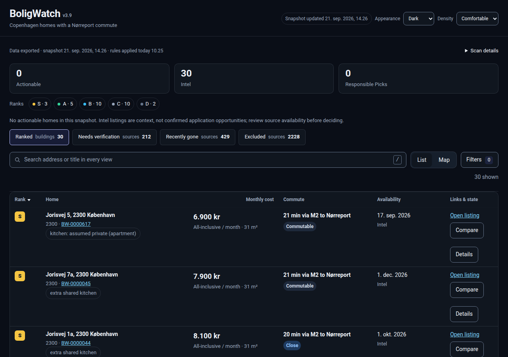
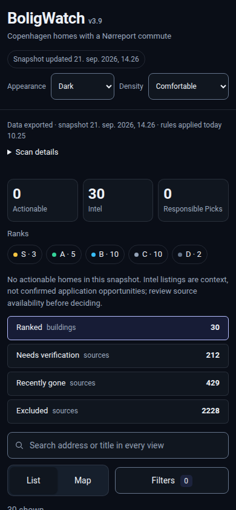

# BoligWatch

A self-hosted rental scanner for Greater Copenhagen. It watches the public
rental portals on a schedule, stores every listing it sees in SQLite, scores
each home against your own budget and commute, and shows the result in a local
web dashboard. Optional Telegram alerts tell you when something worth seeing
appears.

Everything runs on your machine. There is no hosted service, no account, and no
data leaves your computer except the portal requests, map lookups, and the
Telegram messages you enable.



<p align="center">
  
</p>

## What it does

- **Discovers** rentals on Lejebolig and BoligPortal across Greater Copenhagen.
- **Stores** every card it sees, not only the ones that pass today's filters, so
  changing a rule re-scores the whole market without a new scan.
- **Verifies** the things a listing card hides: rooms, private kitchen and
  bathroom, lease type, all-inclusive rent, move-in cost, student or shared
  housing.
- **Models the commute** door to door, including walking, Metro and S-train
  legs, to the destination in your profile.
- **Scores** each home 0–100 and groups the result into S–D rank tiers.
- **Tracks lifecycle**: new, price changed, missing, expired, relisted.
- **Shows** a local dashboard with a ranked table, a map, and separate views for
  needs-verification, recently-gone and excluded listings.
- **Alerts** on Telegram only for a daily digest, a price drop on a shortlist,
  a portal failure, or a new top-ranked home.

## Quick start

Requirements: Python 3.11 or newer, and a desktop environment capable of running
Chromium (for Playwright).

```bash
git clone https://github.com/SharanSivakumar/Bolig-watch-public.git
cd bolig-watch

python3 -m venv .venv
source .venv/bin/activate
pip install -r requirements.txt
playwright install chromium

cp profile.example.json profile.json
$EDITOR profile.json          # set dates, budget, destination and areas

python run.py --dry-run       # scan once, print matches, send nothing
python run.py --serve         # open http://localhost:58240
```

The first scan takes a few minutes. Later scans only open detail pages that are
new or stale. `--dry-run` still reads the portals; it only suppresses alerts.

To rebuild the dashboard from data you already have, without touching a portal:

```bash
python run.py --refresh-local
```

To export a single self-contained HTML file:

```bash
python viewer.py --export report.html
```

## Configure your search

All personal settings live in `profile.json`. The file is git-ignored, so your
budget and preferences never end up in a commit. `profile.example.json` is a
complete, working template; copy it and edit.

Resolution order:

1. `--profile path/to/profile.json` on `run.py` or `viewer.py`
2. `BOLIGWATCH_PROFILE=/path/to/profile.json` for every entry point
3. `profile.json` next to the code

An invalid profile fails at startup with the exact key that is wrong. Unknown
keys are rejected rather than silently ignored.

### Profile reference

| Key | Default | Meaning |
| :--- | :--- | :--- |
| `destination.name` | `Nørreport` | Place name shown in the UI and alerts |
| `destination.lat`, `lon` | Nørreport | Commute target |
| `search.sites` | `["lejebolig", "boligportal"]` | Portals to scan |
| `search.target_move_date` | today + 90 days | Ideal lease start |
| `search.preferred_window_start` / `end` | target ±15 days | Availability window |
| `search.rent_cap_dkk` | `12000` | Hard all-inclusive monthly ceiling |
| `search.affordable_rent_dkk` | `9000` | Rent at which affordability scores full marks |
| `search.move_in_cost_max_dkk` | `60000` | Maximum deposit + prepaid rent + first rent |
| `search.discovery_rent_max_dkk` | `14000` | Store cards up to this rent, even if they fail today |
| `search.rooms_min` / `rooms_max` | `1` / `2` | Accepted room count |
| `search.max_commute_min` | `45` | Reject longer door-to-door commutes |
| `search.max_distance_km` | `10` | Maximum road distance to the destination |
| `search.metro_walk_max_m` | `1500` | Maximum walking distance to a Metro |
| `search.responsible_pick.enabled` | `true` | Allow an S-train fallback when no Metro is near |
| `search.responsible_pick.s_train_walk_max_m` | `800` | S-train walk limit for the fallback |
| `search.responsible_pick.rent_max_dkk` | `10000` | Rent limit for the fallback |
| `areas.lejebolig` | Copenhagen slugs | Lejebolig search areas |
| `areas.bbox` | Greater Copenhagen | `[south, west, north, east]` for BoligPortal |
| `areas.boligportal_max_rooms` | `2` | Portal-side room cap |
| `fit.station_ratings` | `{}` | 0–1 rating per nearest station; empty is neutral |
| `fit.default_rating` | `0.5` | Score for an unrated station |
| `fit.never_postcodes` | `{}` | Postcodes to down-rank, e.g. `{"2700": "Brønshøj"}` |
| `fit.never_zones` | `[]` | Radius zones to down-rank |
| `scoring.*` | 35/20/16/3/4/3/15/4 | Component weights; must sum to 100 |
| `scoring.commute_full_min` / `commute_zero_min` | `15` / `45` | Commute curve anchors |
| `scoring.transit_full_m` / `mid_m` / `zero_m` | `500` / `800` / `1500` | Metro-walk curve anchors |
| `alerts.instant_rank_tiers` | `["S", "A"]` | Ranks that may send an instant alert |
| `alerts.property_cooldown_days` | `7` | Minimum days between alerts for one building |
| `web.host` / `web.port` | `127.0.0.1` / `58240` | Local dashboard binding |
| `complexes` | `{}` | Merge sibling entrances of one building into one row |

Neighbourhood ratings are optional. With an empty `station_ratings` map every
station scores the same, so distance, rent, commute and building quality decide
the ranking. Add ratings only if you have a preference.

### Ranking in one paragraph

The score is the sum of affordability (35), rapid-transit access (20), commute
(16), waterfront (3), centrality (4), street life (3), neighbourhood (15) and
floor height (4). Affordability is linear between `affordable_rent_dkk` (full
marks) and `rent_cap_dkk` (zero). The commute and transit curves are linear
between the anchors above. Value against the market and availability fit are
computed and displayed but contribute no points. Rank letters are derived from
the score: S ≥ 75, A ≥ 60, B ≥ 45, C ≥ 30, D below that.

## Scheduling

The repository includes ready-to-use systemd user units in `deploy/`. They
assume the project lives at `~/bolig-watch`; edit the paths if you cloned it
somewhere else.

```bash
mkdir -p ~/.config/systemd/user
cp deploy/*.service deploy/*.timer ~/.config/systemd/user/

systemctl --user daemon-reload
systemctl --user enable --now boligwatch-scan.timer
systemctl --user enable --now boligwatch-digest.timer
systemctl --user enable --now boligwatch-viewer.service

# Keep user services running after logout
loginctl enable-linger "$USER"
```

| Unit | When | What |
| :--- | :--- | :--- |
| `boligwatch-scan.timer` | 10:00 and 15:00 | One scan |
| `boligwatch-digest.timer` | 10:30 | Telegram digest |
| `boligwatch-viewer.service` | always | Local dashboard on port 58240 |
| `boligwatch-alert.service` | on scan failure | `watchdog.py --failed` |

For hourly scans, set `OnCalendar=hourly` in `boligwatch-scan.timer`. Scans
serialize through a per-database lock, so a manual scan and a scheduled scan
cannot corrupt each other.

A plain cron alternative:

```cron
0 10,15 * * *  cd "$HOME/bolig-watch" && ./run.sh >> boligwatch.log 2>&1
30 10 * * *    cd "$HOME/bolig-watch" && .venv/bin/python digest.py >> boligwatch.log 2>&1
```

## Command line

| Command | Purpose |
| :--- | :--- |
| `python run.py --dry-run` | Scan and print matches, send no alerts |
| `python run.py` | Scan and allow alerts |
| `python run.py --sites boligportal --limit 5 --dry-run` | Narrow test scan |
| `python run.py --refresh-local` | Re-score stored listings, rebuild `report.html`, no portal request |
| `python run.py --refresh-local --enrich` | Same, and fill missing geocode/route/buzz data |
| `python run.py --rescore` | Historical alias of a full local re-score |
| `python run.py --fetch-details --select stale` | Re-open detail pages older than 7 days |
| `python run.py --fetch-details --ids lejebolig#1902885` | Open named detail pages |
| `python run.py --serve` | Local dashboard |
| `python run.py --audit-integrity` | Read-only database integrity audit |
| `python run.py --set-profile-age 27` | Store an age used by age-restricted housing |
| `python viewer.py --export report.html` | Standalone HTML export |
| `python digest.py --dry-run` | Print the daily digest without sending |

Use `--db path/to/copy.db` to run a command against a copy of the database.

## Telegram (optional)

Without credentials the bot and digest stay silent. To enable them:

1. Create a bot with [@BotFather](https://t.me/BotFather).
2. Send it a message, then read your chat id from
   `https://api.telegram.org/bot<TOKEN>/getUpdates`.
3. Export both values before starting the bot:

```bash
export BOLIGWATCH_TG_TOKEN="123456:ABC..."
export BOLIGWATCH_TG_CHAT_ID="123456789"
python bot.py
```

The bot is text-first by design: no photos, no link previews, no emoji. Commands
include `/latest`, `/details`, `/save`, `/shortlist`, `/dismiss`, `/status`,
`/search` and `/summary`. It accepts `BW-0000045`, `BW-45` or `45`.

Alert volume is deliberately low. Only four things send a message: the daily
digest, a price drop on a shortlisted home, a portal that stopped returning
results, and a new S- or A-ranked home.

## How a scan works

1. **Discovery** reads result cards for each area. Cards are stored whatever
   their rent, so a later rule change does not need a re-scan.
2. **Detail fetch** opens the listing page for cards that are new, stale, or
   decision-relevant. The detail page is what proves kitchen, bathroom, lease
   type and total rent.
3. **Geocoding and routing** resolve the address, then model walking, Metro and
   S-train legs to the destination.
4. **Local evaluation** applies your eligibility rules, computes the score and
   writes the match row. This step never contacts a portal.
5. **Export** rebuilds `report.html` and the payload the local server serves.

A broken or partial scan never expires listings. Only a scan that proves it saw
the whole site may count a miss as a miss, and three complete misses expire a
listing.

## Data and external services

Every external call is cached. A scan with all of them unavailable still
finishes.

| Service | Key | If unavailable |
| :--- | :--- | :--- |
| DAWA (Danish address geocoding) | none | listing is quarantined and retried |
| FOSSGIS OSRM (walking and driving) | none | calibrated fallback estimate |
| OpenRouteService | optional `ORS_API_KEY` | falls back to OSRM |
| Overpass (streets, buses, water) | none | features are retried later |
| Rejseplanen | optional `REJSEPLANEN_ACCESS_TOKEN` | offline transit model |
| Google Maps | optional `GOOGLE_MAPS_API_KEY` | OSRM fallback |

Reference data (`metro_stations.json`, `s_tog_stations.json`,
`transit_lines.json`, `station_commute.json`, `water_edges.json`) is included.
Regenerate it with:

```bash
python generate_stations.py
python generate_transit.py            # add --curated to skip Overpass
python generate_water.py
```

If you change `destination` in the profile, regenerate `station_commute.json`
so the offline ride-time table targets the new place.

## Project layout

```text
├── run.py                 # scan orchestrator and CLI
├── viewer.py              # local dashboard and static HTML export
├── bot.py                 # optional Telegram command listener
├── digest.py              # daily Telegram digest
├── notify.py              # Telegram formatters
├── watchdog.py            # failed-run and stale-scan alerts
├── config.py              # default thresholds, weights and curves
├── profile.py             # JSON profile loader and validator
├── profile.example.json   # template profile
├── tiers.py               # rank tiers and legend metadata
├── filters.py             # eligibility, verification and scoring
├── fetchers.py            # portal extractors
├── store.py               # SQLite schema, lifecycle and shortlist
├── geo.py                 # geocoding, routing and offline transit model
├── features.py            # street life, waterfront, place features
├── benchmarks.py          # market segments and value vs market
├── nethttp.py             # cached HTTP client
├── generate_*.py          # reference-data builders
├── deploy/                # systemd user units and timers
├── docs/images/           # README screenshots
└── tests/                 # 790+ offline tests
```

The database (`boligwatch.db`), logs, `geo_cache.json`, `report.html` and
`profile.json` are created at runtime and git-ignored.

## Tests

```bash
python -m pytest -q
```

The suite is offline: portal clients, geocoding, routing and Overpass are
stubbed. It uses a fixed test profile in `tests/fixtures/test_profile.json`, so
your own `profile.json` cannot change a test result.

## Troubleshooting

- **`playwright: command not found`** — activate the virtualenv, then run
  `playwright install chromium`.
- **A portal returns zero cards** — the portal may have changed its markup. The
  scan records the failure instead of expiring listings; check
  `python run.py --audit-integrity` and the log.
- **Port 58240 is busy** — use `python run.py --serve --port 58241` or change
  `web.port` in the profile.
- **Profile changes do not appear** — the profile is read at import, so restart
  the viewer or bot after editing it.
- **Every listing is quarantined** — detail pages could not be read. Run
  `python run.py --fetch-details --select evidence-failed` and check the log.

## Responsible use

This tool reads public listing pages at a human-like pace with a normal browser
user agent. Respect each portal's terms of service and `robots.txt`. Do not
raise concurrency, hammer detail pages, or use the data commercially without
permission. The repository contains no portal credentials and no scraped
database.

Rental listings change quickly. Always confirm rent, deposit, lease length and
move-in date with the landlord before paying anything.

## License

MIT. See [LICENSE](LICENSE).
